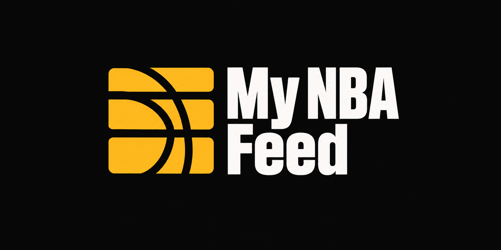

# 🏀 My NBA Feed



**Live →** [my-nba-feed.vercel.app](https://my-nba-feed.vercel.app)

---

## The Problem

Modern sports apps aren't built for fans — they're built for engagement metrics.

You open the NBA app to check one score and get hit with ads, push notification prompts, recommended content you didn't ask for, and an algorithm trying to keep you scrolling. Reddit buries the game thread under memes and hot takes. ESPN wants you to subscribe. Google shows you highlights you didn't want to see yet.

The result: checking on your team becomes a chore. You either get spoiled, get distracted, or give up and wait for someone to tell you.

## The Solution

NBA Feed cuts all of that out.

One page. Your team. The score, the record, the next game, the schedule, and what fans are actually saying — with spoiler-free mode on by default so you control when you see results. No ads. No algorithm. No recommendations. No paywall. No FOMO loop.

Just basketball, on your terms.

---

## Features

- **Live Scores** — Real-time game scores for today's matchups across the league
- **Team Dashboard** — Last game result, next game preview, and current W/L record — all in one view
- **Standings** — Full conference standings updated live
- **Schedule** — Upcoming games for any team
- **Team Compare** — Head-to-head stat comparison between any two teams (PPG, OPPG, record)
- **Social Feed** — Reddit-powered fan feed per team (r/lakers, r/bostonceltics, etc.)
- **Spoiler-Free Mode** — Hide scores until you're ready to see them. Remembered across sessions.
- **Team Selector** — Switch between all 30 NBA teams. Picks up the team's colors automatically.

---

## Brand and Logo

**Option C — The Feed** is the approved logo direction, selected on October 27, 2026:
an amber basketball/feed mark with a condensed **My NBA Feed** wordmark. The primary
logo and horizontal, light-background and standalone-mark variations are saved in
[`public/branding/`](public/branding/). See the [brand guide](docs/branding.md) for
asset links, intended uses, generation prompts and current limitations.

The shared navigation displays the primary stacked logo, and the standalone mark
is encoded as the browser favicon. Application copy continues to use **NBA Feed**
as its short name.

---

## Tech Stack

| Layer | Tech |
|---|---|
| Framework | Next.js 16 (App Router) |
| Language | TypeScript |
| Styling | Tailwind CSS |
| Data | balldontlie API + Google News RSS + Reddit JSON |
| Deployment | Vercel |

---

## Project Structure

```
src/
├── app/
│   ├── page.tsx              # Main team dashboard
│   ├── standings/            # League standings
│   ├── schedule/             # Team schedule
│   ├── compare/              # Team vs team comparison
│   ├── highlights/           # Highlights feed
│   └── api/                  # Server-side API routes
│       ├── games/            # Game data + live scores
│       ├── standings/        # Standings data
│       ├── schedule/         # Schedule data
│       ├── compare/          # Team comparison logic
│       ├── social/           # Reddit feed proxy
│       └── players/          # Player data
├── components/
│   ├── TeamHeader.tsx        # Team banner with dynamic colors
│   ├── GameSection.tsx       # Last game + next game cards
│   ├── LiveScores.tsx        # Live scoreboard ticker
│   ├── NewsFeed.tsx          # Team news feed
│   ├── TeamSelector.tsx      # Team picker (all 30 teams)
│   └── ...
├── hooks/
│   ├── useGameData.ts        # Game data fetching + polling
│   ├── useTeam.ts            # Selected team state
│   └── useSpoilerMode.ts     # Spoiler-free toggle (localStorage)
└── lib/
    ├── api.ts                # API client + TypeScript interfaces
    ├── teams.ts              # All 30 teams with IDs and colors
    ├── reddit.ts             # Reddit subreddit mappings per team
    └── nbaDate.ts            # NBA timezone-aware date helpers
```

---

## Getting Started

```bash
# Clone
git clone https://github.com/PeterTechDev/my-nba-feed.git
cd my-nba-feed

# Install
npm install

# Run locally
npm run dev
```

Open [http://localhost:3000](http://localhost:3000).

Set `BALLDONTLIE_KEY` in your environment before starting the app.

### Digest storage and publishing

Connect a **private Vercel Blob store** to the project. Production uses the
automatically configured `BLOB_STORE_ID` and Vercel OIDC; no browser receives a
storage credential. Include **Development** in the store's project connections;
a Production/Preview-only connection leaves local digest APIs returning 503.
For local development Blob access, pull development credentials
with `vercel env pull .env.development.local`. Keep all secrets in ignored environment
files and preserve the publisher token in `.env.local` when pulling development values.
Refresh the pulled credentials when the short-lived local OIDC token expires.

Set a server-only `DIGEST_PUBLISH_TOKEN` for the external digest publisher.
Publish to `POST /api/digest` with `Authorization: Bearer <DIGEST_PUBLISH_TOKEN>`
and a JSON body containing `date` (YYYY-MM-DD), `style` (hype, analytical, casual
or storyteller), `title`, `content` (Markdown), and optional `games_covered`,
`stats_highlighted` and `metadata`. Publishing the same date replaces that entry.
Digests and aggregated reactions persist in private Blob documents; conditional
writes prevent concurrent updates from silently overwriting each other.

The [Daily NBA Digest cloud workflow](https://github.com/PeterTechDev/my-nba-feed/actions/workflows/digest.yml)
runs on GitHub Actions at 08:00 America/Bahia, using a free Qwen model on the cloud
runner's CPU and the authenticated publisher. It needs no paid inference API,
local computer or Codex session. Configure `DIGEST_PUBLISH_TOKEN` as a repository Actions secret. Existing daily editions
are preserved unless a manual recovery run explicitly replaces today's edition.
An independent maintenance job renews the workflow's activation automatically,
preventing GitHub's 60-day inactivity suspension without human commits or a local
computer. See [the publisher runbook](docs/digest-publisher.md) for verification,
permissions and the free public-runner requirement.
Empty content is shown only after a successful read; storage failures have a retry action.

### Data fallbacks

Rosters use BALLDONTLIE active players, falling back to the current ESPN roster
when the API plan or service does not provide active players. Social tries Reddit
JSON, then its RSS feed, then a clearly identified news index of Reddit links.
Missing votes/comments are omitted rather than presented as zero.

### Regression checks

Run `node scripts/test-digest-writes.mjs` with development Blob credentials to
check publishing, replacement, validation and concurrent reactions against real
storage. It uses a unique test folder and deletes its documents afterward.

Highlights use full-game videos from the NBA's official YouTube channel, with an
inline player loaded only after clicking Play. A daily GitHub Actions job uses the
official API and saves matches in private Blob storage; page visits never call
the YouTube Data API. Previews and players respect spoiler protection. Configure
the `YOUTUBE_API_KEY` Actions secret using the [setup guide](docs/youtube-highlights.md).

Run `npm test` for the Node suite, `npm run test:ssr` for the Morning Briefing
server render, and `npm run test:e2e` for Playwright. `test:e2e` needs `BASE_URL`.
`VERCEL_BYPASS` is required when that origin is not localhost. The bypass
header is sent only to that origin and is not forwarded across a redirect.
`SMOKE_ALLOW_MISSING_API_KEY` defaults to empty, which does not tolerate any
503 console line. Set the repository variable to `1` only when the preview has
no BALLDONTLIE key or digest storage. That value tolerates 503 for the exact
paths `/api/games`, `/api/standings`, and `/api/digest`. `/api/digest/feedback`
is not tolerated.

---

## Screenshots

> Dashboard showing team record, last game, next game, and Reddit social feed.

*Coming soon*

---

## Roadmap

- [ ] Push notifications for game start and final score
- [ ] Player stats page
- [ ] Playoff bracket view
- [ ] Mobile PWA support

---

## Author

**Peter Souza** — [peterleite.dev@gmail.com](mailto:peterleite.dev@gmail.com)

SDET · AI Developer · Building in public

[](https://linkedin.com/in/peter-souza)
[](https://my-nba-feed.vercel.app)
